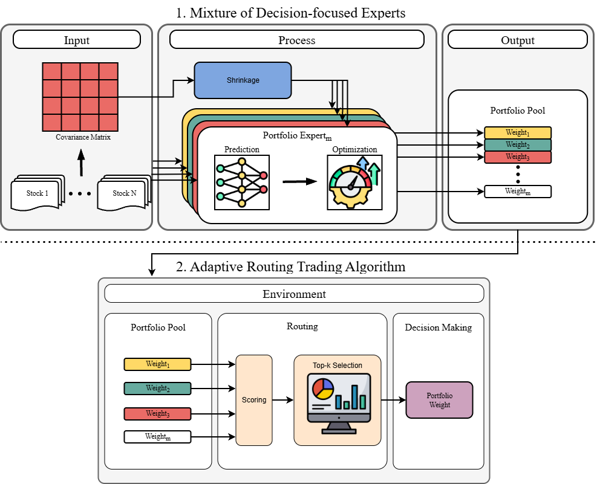

# Mixture of Decision-Focused Portfolio Experts with Adaptive Routing

Code for the paper **"Mixture of Decision-Focused Portfolio Experts with Adaptive Routing for Mean–Variance Portfolio Optimization"** (under review).

Each *portfolio expert* is a neural return-prediction backbone (MLP, LSTM, or Transformer) trained end-to-end through a
differentiable mean–variance optimization (MVO) layer, so that its forecasts are optimized for the portfolio decisions they
induce rather than for prediction error alone. Twenty experts are trained with the same configuration but different random
seeds, and the resulting heterogeneous pool is combined in two ways:

- **Ensemble** — equally average the portfolio weights of all experts every day.
- **Router** — every *H* trading days, rank the experts by their recent realized return and prediction–realization
  alignment, keep the top-*k*, and equally average their daily portfolio weights until the next routing time.

## Method



**Stage 1 — decision-focused experts** (`src/agents.py:DFLMVOModel`). The backbone maps a 60-day window of returns of the
20 assets to an expected-return vector `μ̂`. A `cvxpylayers` MVO layer turns `μ̂`, a Ledoit–Wolf shrinkage covariance, and
the previous weights into a long-only portfolio with a per-asset cap and an L1 turnover penalty. Training minimizes
`α · regret_MVO + (1 − α) · 1000 · MSE`, where the regret is the utility gap between the ex-post optimal portfolio and the
prediction-driven portfolio, evaluated on realized returns.

**Stage 2 — adaptive routing** (`src/multi_experts_router_testing.py:_zscore_router`). At each routing time the router
scores every expert with the cross-expert z-score of its compounded return over the formation window plus the z-score of
its exponentially weighted (decay `β`) prediction–realization alignment, selects the top-*k*, and holds that subset for the
next *H* days while the portfolio itself is still rebalanced daily. The number of experts *k* is either fixed (static-*k*)
or chosen per test year on the preceding validation year (validation-selected *k*).

**Baselines** (`src/financial_baseline.py`, enabled with `--run_baseline`): Equal Weight (1/N), Auto Reweight (sample MVO
re-estimated every `--rebalance_freq` months), and buy-and-hold of a single index (default MXWO).

## Contents

All code lives in `src/`. Scripts are run from the repository root (they read `./dataset/...` by default).

### Runnable entry points

| Script | Stage | What it does |
|---|---|---|
| `multi_seed_sequential_training.py` | train | Train one expert per seed (20 seeds by default) for one or more test years |
| `multi_experts_router_testing.py` | evaluate | Every seed, **Experts** (cross-seed mean ± std), **Ensemble**, and **Router**; optional grid search of router parameters on the validation year; single- or multi-year |
| `multi_experts_ensemble_testing.py` | evaluate | Every seed, **Experts**, and **Ensemble (equal weight)** only, with optional group-weight floor constraints in the MVO layer |
| `router_bootstrap_variance.py` | evaluate | Bootstrap over the expert pool to obtain mean ± std for Ensemble / Router (static-*k* or validation-selected *k*) |

### Library modules

| Module | What it provides |
|---|---|
| `agents.py` | MLP / LSTM / Transformer backbones, the differentiable MVO layer, the hybrid regret + MSE loss, and `DFLMVOModel` |
| `dataloader.py` | Price loading, the expanding-window train / validation / test split by test year, and rolling-window datasets with Ledoit–Wolf covariance |
| `backtest_utils.py` | Shared evaluation code: checkpoint loading and inference, drift-adjusted daily returns with transaction costs, multi-year stitching, per-strategy output folders, metrics, and common plots |
| `financial_baseline.py` | Equal Weight, Auto Reweight (MVO), and single-asset baselines blended with the risk-free asset |
| `utils.py` | Performance metrics (total / annualized return, volatility, Sharpe, Sortino, max drawdown), risk-free rate loader, cost-to-alpha ratio |

## Requirements

```
python 3.12 (tested)
torch  cvxpy  cvxpylayers  numpy  pandas  matplotlib  scipy  scikit-learn  tqdm  tensorboard
```

Developed with Python 3.12.9, PyTorch 2.7.0 + CUDA 12.8, CVXPY 1.7.5, cvxpylayers 1.0.3, scikit-learn 1.7.2, pandas 2.3.3,
and NumPy 2.4.2 on an NVIDIA RTX 5080. A GPU is not required, but training is slow without one.

```bash
pip install -r requirements.txt
```

`requirements.txt` pins minimum versions (`>=`) only.

## Data

The data is licensed vendor data and is **not included**. See [`dataset/README.md`](dataset/README.md) for the exact
files, column formats, and Bloomberg tickers.

| Location | Format | Feeds |
|---|---|---|
| `dataset/market_index/*.csv` | one file per asset; `Dates` + `PX_LAST` columns | the 20-asset price panel |
| `dataset/risk_free_index/US zero coupon bond-rf.csv` | Bloomberg zero-coupon yield export, 6 header rows | the risk-free sleeve and the Sharpe / Sortino benchmark |

## How to run

**1. Train the expert pool** (20 seeds by default; one or more test years):

```bash
python src/multi_seed_sequential_training.py --model_type transformer --test_year 2022 2023 2024 2025
```

**2. Evaluate Experts, Ensemble, and Router** with the routing configuration of the paper
(formation window `L = 90`, holding period `H = 60`, decay `β = 0.94`, combined return + alignment score, top-3):

```bash
python src/multi_experts_router_testing.py --model_type transformer --test_year 2022 \
  --score_method cumret_mucorr --rolling_window 90 --review_freq 60 --combo_beta 0.94 --top_k 3 \
  --run_baseline
```

- Validation-selected *k*: add `--grid_search --gs_top_k 1 3 5 7 9 11` (the grid search uses only the year before the test year).
- Several years at once: `--test_year 2022 2023 2024 2025` stitches them into one continuous backtest and additionally writes
  `per_year_performance_summary.csv`.

**3. Evaluate Experts and Ensemble only:**

```bash
python src/multi_experts_ensemble_testing.py --model_type transformer --test_year 2022 --stock_weight 0.6 --run_baseline
```

**4. Bootstrap mean ± std for Ensemble and Router** (30 resampled expert pools per year, as in the paper):

```bash
python src/router_bootstrap_variance.py --model_types transformer --test_years 2022 2023 2024 2025 \
  --router_modes static validation_selected ensemble --n_bootstrap 30 \
  --score_method cumret_mucorr --rolling_window 90 --review_freq 60 --combo_beta 0.94
```

### Configuration

| Component | Flags |
|---|---|
| Backbone | `--model_type` `mlp` \| `lstm` \| `transformer` |
| Test year(s) | `--test_year` `2022` `2023` `2024` `2025` (several allowed) |
| Training | `--alpha` (0.75), `--risk_aversion` (1.0), `--max_weight` (0.2), `--transaction_cost` (0.002), `--seeds` |
| Routing | `--score_method` (`sharpe`, `cumret`, `mu_corr`, `ic_ir`, `w_corr`, `cumret_mucorr`), `--rolling_window` (0 = expanding), `--review_freq`, `--top_k` / `--bottom_k`, `--combo_beta`, `--combo_alpha`, `--warmup_days` |
| Backtest | `--stock_weight` (risky share; the rest earns the risk-free rate), `--transaction_cost`, `--weight_rebalance_freq` `daily` \| `weekly` \| `biweekly` \| `monthly` \| `quarterly` \| `semiannual` |
| Window | `--start_day` / `--end_day` (single-year mode) |
| Risk-free rate | `--risk_free_source` `bill` \| `g0q0` (router script) |
| Group floor | `--group_assets`, `--group_weight_threshold`, `--enforce_group_floor` (ensemble script) |
| Baselines | `--run_baseline`, `--rebalance_freq` (Auto Reweight, months: `0.25` `0.5` `1` `3` `6` `12`), `--single_stock_file` |

Training uses AdamW with `ReduceLROnPlateau`; gradients are clipped to `max_norm = 1.0` for LSTM and Transformer.
Use `--no_save` on either evaluation script to skip all file output and print a single `METRICS_JSON:` line instead.

## The asset universe — 20 indices

12 global equity indices and 8 fixed-income indices; the split used for the equity / bond / risk-free weight plots is
`backtest_utils.py:_BOND_TICKERS`.

<table>
<tr><th>Global Equity (12)</th><th>Fixed Income (8)</th></tr>
<tr><td>

| Ticker | Index |
|---|---|
| `SPX` | S&P 500 |
| `CCMP` | Nasdaq Composite |
| `RTY` | Russell 2000 |
| `MXWO` | MSCI World |
| `MXWD` | MSCI ACWI |
| `MXEF` | MSCI Emerging Markets |
| `SXXP` | STOXX Europe 600 |
| `NKY` | Nikkei 225 |
| `HSCEI` | Hang Seng China Enterprises |
| `TWSE` | TAIEX |
| `SENSEX` | S&P BSE Sensex |
| `IBOV` | Ibovespa |

</td><td>

| Ticker | Index |
|---|---|
| `LEGATRUU_Index` | Bloomberg Global Aggregate |
| `LBUSTRUU_Index` | Bloomberg US Aggregate |
| `G0Q0_Index` | ICE BofA US Treasury |
| `C0A0_Index` | ICE BofA US Corporate |
| `H0A0_Index` | ICE BofA US High Yield |
| `EMUSTRUU_Index` | Bloomberg EM USD Aggregate |
| `LP06TREU_Index` | Bloomberg Pan-European Aggregate |
| `LP01TREU_Index` | Bloomberg Pan-European High Yield |

</td></tr>
</table>

Risk-free rate: USD Treasury zero-coupon yield, 3-month (`I02503M Index`).

## Hyperparameters

| | Default |
|---|---|
| Lookback window | 60 trading days |
| Experts per backbone *M* | 20 (seeds `0 2 4 42 181 276 370 413 475 512 518 783 788 831 1091 1231 1405 1497 1560 2024`) |
| Optimizer / learning rate / weight decay | AdamW / 1e-4 / 1e-4 |
| Batch size / max epochs | 16 / 200 |
| Validation interval / early-stopping patience | every 5 epochs / 10 validations |
| Hybrid-loss weight `α` | 0.75 |
| Risk aversion `λ` / turnover penalty `γ` / max asset weight | 1.0 / 0.002 / 0.2 |
| Formation window `L` / holding period `H` / decay `β` | 90 / 60 trading days / 0.94 |
| Static `k` / validation candidates | 3 / {1, 3, 5, 7, 9, 11} |
| Risky / risk-free allocation | 60% / 40% |
| Transaction cost (backtest) | 20 bps per unit traded |

Train / validation / test split per test year *y*: training 2000 – *y*−2, validation *y*−1, test *y*
(2025 ends on 2025-10-09).

## Results

Four-year average (2022–2025) out-of-sample performance, Transformer backbone, from Table 6 of the paper. Ensemble and
Router entries are mean ± std over 30 bootstrap resamples of the expert pool; Experts and the learning-based baselines are
mean ± std across seeds.

| Model | Ann. Return (%) | Ann. Vol (%) | Sharpe | Sortino | Max DD (%) |
|---|---:|---:|---:|---:|---:|
| Equal Weight (1/N) | 5.55 | 4.76 | 0.43 | 0.42 | 6.10 |
| Sample MVO | 3.29 | **2.37** | −0.10 | −0.22 | **3.93** |
| Global market index (ETF) | 7.76 | 8.75 | 0.56 | 0.72 | 9.44 |
| EIIE | 3.67 ± 2.20 | 4.64 ± 0.99 | 0.08 ± 0.51 | −0.01 ± 0.61 | 6.40 ± 1.08 |
| RAT | 5.12 ± 0.64 | 6.51 ± 0.24 | 0.33 ± 0.08 | 0.28 ± 0.10 | 8.46 ± 0.33 |
| PPN | 5.31 ± 2.09 | 5.44 ± 1.04 | 0.41 ± 0.31 | 0.37 ± 0.49 | 6.69 ± 1.42 |
| DeepTrader | 7.27 ± 2.61 | 7.02 ± 1.71 | 0.52 ± 0.46 | 0.66 ± 0.74 | 7.14 ± 1.27 |
| DeepAries | 9.59 ± 1.88 | 7.96 ± 0.38 | 0.39 ± 0.22 | 0.37 ± 0.29 | 9.55 ± 0.89 |
| Ours (Experts) | 16.76 ± 2.89 | 7.56 ± 0.60 | 1.50 ± 0.32 | 2.31 ± 0.54 | 5.05 ± 0.68 |
| Ours (Ensemble) | 16.79 ± 0.49 | 7.28 ± 0.11 | 1.57 ± 0.06 | 2.38 ± 0.10 | 4.78 ± 0.12 |
| **Ours (Router *k* = 3)** | **18.92 ± 1.21** | 7.61 ± 0.15 | **1.73 ± 0.14** | **2.63 ± 0.24** | 4.98 ± 0.30 |
| Ours (Validation-selected *k*) | 17.66 ± 1.39 | 7.54 ± 0.20 | 1.60 ± 0.18 | 2.39 ± 0.29 | 5.04 ± 0.38 |

2022 is the one test year in which every conventional and reinforcement-learning baseline finished negative; the Router
(*k* = 3) earned 11.32% with a Sharpe ratio of 0.89. Per-year results, ablations, and sensitivity analyses are in the paper.

## Output folder convention

```
checkpoints/{model_type}/testYear{year}/seed{seed}/
    checkpoint_best.pt            # best validation loss; used by all evaluation scripts
    checkpoint_epoch_{N}.pt       # every 10 epochs from epoch 100
    config.json, training_history.csv, training_history.png
runs/{model_type}/testYear{year}/seed{seed}/        # TensorBoard
logs/training/{model_type}/testYear{year}/seed{seed}/

results/{model_type}/{testYear{year} | multiYear_{years}}/testTime{timestamp}/                   # router script
ablation_study_results/{model_type}/{testYear{year} | multiYear_{years}}/testTime{timestamp}/    # ensemble script
    performance_summary.csv       # one row per seed, Experts, Ensemble, (Router), baselines
    seed{k}/, ensemble_experts/, ensemble_equal_weight/, ensemble_router({score_method})/
        daily_returns.csv, weights_history.csv, cost_metrics.csv, turnover_analysis.csv, plots
bootstrap_results/                                  # bootstrap script
```

`performance_summary.csv` stores returns, volatility, and drawdown as percentages (e.g. `14.22`), with Experts entries
written as `mean ± std`.

## Known limitations

- **Data is not included.** The CSV files must be prepared as described in [`dataset/README.md`](dataset/README.md),
  including the USD conversion and market-close lag of Section 4.1, which the code does not perform.
- **Trained checkpoints are not included.** Run step 1 before any evaluation script.
- **Asset order is defined by file names.** A checkpoint is tied to the exact set of 20 files it was trained on; renaming,
  adding, or removing files changes the asset order and invalidates existing checkpoints.

## References

**Decision-focused learning and portfolio optimization**
- Elmachtoub, A. N., & Grigas, P. (2022). Smart "predict, then optimize". *Management Science*, 68(1), 9–26.
- Agrawal, A., Amos, B., Barratt, S., Boyd, S., Diamond, S., & Kolter, Z. (2019). Differentiable convex optimization layers. *NeurIPS*.
- Butler, A., & Kwon, R. H. (2023). Integrating prediction in mean-variance portfolio optimization. *Quantitative Finance*, 23, 429–452.
- Mandi, J., et al. (2024). Decision-focused learning: Foundations, state of the art, benchmark and future opportunities. *JAIR*, 80, 1623–1701.

**Estimation and optimization**
- Markowitz, H. (1952). Portfolio selection. *The Journal of Finance*, 7, 77–91.
- Ledoit, O., & Wolf, M. (2004). Honey, I shrunk the sample covariance matrix. *The Journal of Portfolio Management*, 30, 110–119.
- DeMiguel, V., Garlappi, L., & Uppal, R. (2009). Optimal versus naive diversification: How inefficient is the 1/N portfolio strategy? *The Review of Financial Studies*, 22, 1915–1953.

**Ensembles, mixtures of experts, and forecast combination**
- Lakshminarayanan, B., Pritzel, A., & Blundell, C. (2017). Simple and scalable predictive uncertainty estimation using deep ensembles. *NeurIPS*.
- Fort, S., Hu, H., & Lakshminarayanan, B. (2020). Deep ensembles: A loss landscape perspective. *ICLR*.
- Jacobs, R. A., Jordan, M. I., Nowlan, S. J., & Hinton, G. E. (1991). Adaptive mixtures of local experts. *Neural Computation*, 3, 79–87.
- Aiolfi, M., & Timmermann, A. (2006). Persistence in forecasting performance and conditional combination strategies. *Journal of Econometrics*, 135, 31–53.

## Citation

The paper is currently under review. Citation information will be added once it is published.

## License

No license file is included yet. Until one is added, all rights are reserved.
